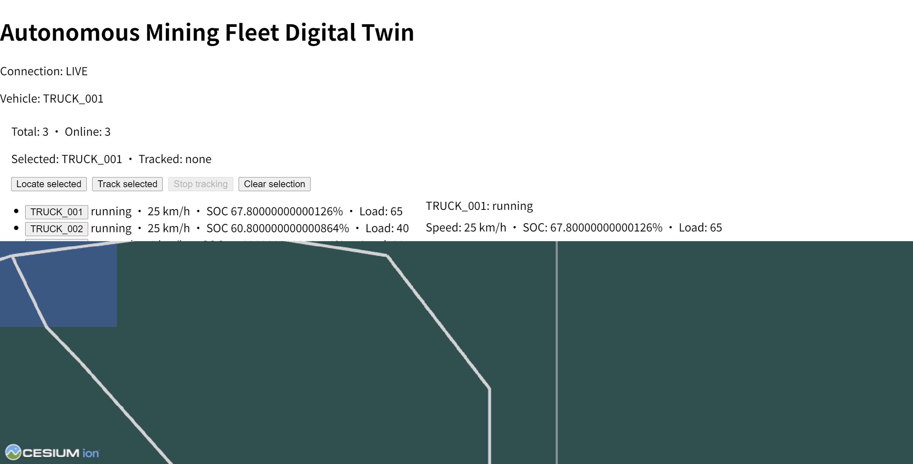
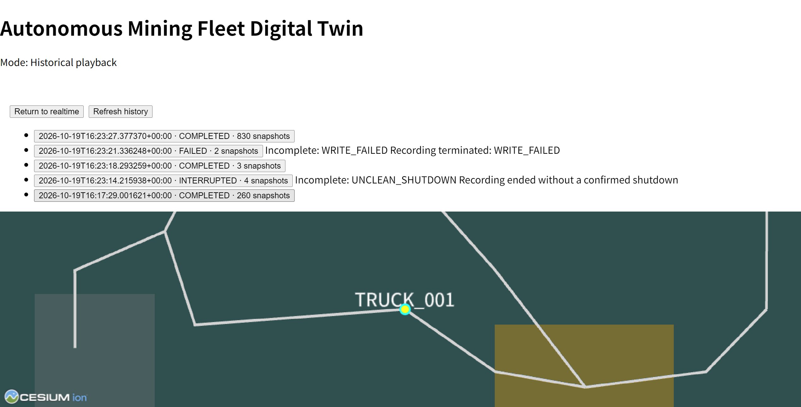
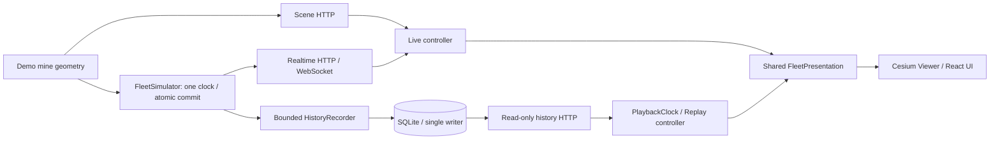

# Autonomous Mining Fleet Digital Twin

**Portfolio MVP / Non-production prototype** · 面向2027届校招的矿卡数字孪生展示项目

**Python / FastAPI / SQLite / WebSocket · React / TypeScript / CesiumJS**

模拟矿山中的三车实时监控与历史回放：统一仿真时钟、完整车队快照、有界异步录制，以及可独立暂停/跳转的历史展示。不实现自动驾驶控制、真实车辆接入或生产部署。

## 真实运行截图

### LIVE


### REPLAY


以上为真实Chrome/Cesium验收原图，非生成图。截图是近景和局部面板，不代表同屏能看到全部车辆；16个Entity和动态行为由真实对象及运行记录核验。

## 功能与工程重点

- 三辆矿卡共用处理后的矿山路线，独立位置、速度、航向、SOC、载荷及running/stopped状态。
- 唯一后台仿真时钟；全车候选验证后原子提交，HTTP/WS读取同一份完整快照。
- 13静态矿山Entity+3车辆Entity；稳定车辆身份，选择与相机跟踪分离。
- SQLite会话和完整快照：记录seq0及成功提交，128包有界队列、单writer；磁盘故障不回滚实时状态。
- 只读分页历史HTTP；仅COMPLETED/FAILED/INTERRUPTED回放，不完整前缀保留提示。
- 0.5/1/2/4倍速、暂停、双向seek、结束和显式重播；BUFFERING冻结时间，恢复不追赶。
- 离散采样缺口保留上一真实快照，不插值、不补帧、不预测位置或SOC。
- LIVE/REPLAY生命周期隔离，释放旧Viewer、WS、HTTP、rAF；保留Cesium通知异常的本地fatal边界。

## 简洁架构



回放不调用实时模拟器step。三维显示使用虚拟椭球高的模拟矿山，无真实DEM、测绘地形或在线矿山数据。

## 环境

已验收：Python3.12.14、Node24.21.0、npm11.19.0、SQLite3.53.1、Chrome155.0.8059.40、真实WebGL2。
后端验收版本包括FastAPI0.141.1、Uvicorn0.54.0、Starlette1.7.0、pytest9.1.1、httpx0.28.1、pyproj3.7.2；前端见package-lock.json（Cesium1.146.0、React19.3.0）。

后端四项直接依赖未固定版本。以下使用同一应用入口和验收配置；公开整理未重新安装或运行，不保证未来任意依赖版本组合均可复现。

## 本地运行（PowerShell，公开副本根目录）

预先准备Python3.12与Node24，首次安装：

```powershell
py -3.12 -m venv .venv
.\.venv\Scripts\python.exe -m pip install -r backend/requirements.txt
Push-Location frontend
npm ci
Pop-Location
```

### 1. 配置独立历史目录，启动单worker后端

在第一个PowerShell窗口、项目根目录执行：

```powershell
$env:PHASE2D_HISTORY_DIR = [IO.Path]::GetFullPath((Join-Path $PWD '.history'))
$env:PHASE2D_HISTORY_MAX_DB_BYTES = '536870912'
.\.venv\Scripts\python.exe -m uvicorn backend.main:app --host 127.0.0.1 --port 8000
```

默认单worker，不添加`--reload`或多worker；一个目录仅一个writer。所有路径相对公开副本，使用新目录，不指向其他业务库。

额度须显式设置，至少16777216 bytes且为4096的整数倍。**512MiB只是本地验收配置，不是生产默认**；无有效配置为`DISABLED_CONFIG`，LIVE仍可用但不录制。额度约束主DB，不是目录、WAL/journal或磁盘总占用上限。没有自动删历史功能。

可选`PHASE2D_CODE_REVISION`仅接受40位Git提交标识，省略则记录null；本目录尚无独立提交时，不要把旧私有SHA冒充本次运行提交。

### 2. 前端和录制观测

第二个窗口：

```powershell
Set-Location frontend
npm run dev
```

访问[本地页面](http://127.0.0.1:5173/)。第三个窗口只读检查：

```powershell
Invoke-RestMethod http://127.0.0.1:8000/health
Invoke-RestMethod http://127.0.0.1:8000/api/history/status | ConvertTo-Json
```

确认`RECORDING`及seq0已持久化。录制数秒即可演示回放；观察默认停车/恢复需跨过60/75/90/110模拟秒。首次没有终态历史是正常情况。

### 3. 正常停止、确认终态，再重启回放

后端窗口按Ctrl+C，等待进程退出及应用关闭完成。**端口不监听不等于进程已退出**。确认退出后，从根目录只读检查：

```powershell
.\.venv\Scripts\python.exe -c "import sqlite3; from pathlib import Path; p=Path('.history/fleet-history.sqlite3').resolve(); c=sqlite3.connect(p.as_uri()+'?mode=ro',uri=True); print(c.execute('SELECT session_id,state,snapshot_count,last_sequence FROM history_sessions ORDER BY started_utc DESC LIMIT 1').fetchone()); c.close()"
```

应为`COMPLETED`。若关闭未完成，停止流程、保留日志和进程现场，不要再启动第二writer或改写数据库。

在相同目录/配置下重启步骤1的后端。点击 **Enter history**，选择旧COMPLETED会话，再用 **Play / Pause、Rate、Seek、Replay from start**。RECORDING不能回放；FAILED/INTERRUPTED可读但标不完整。**Return to realtime**返回LIVE。

### Production Preview

停止dev后，在frontend执行；后端保持运行：

```powershell
npm run build
npm run preview
```

preview也使用5173，不能与dev同时占用。构建从安装的Cesium复制Assets、ThirdParty、Widgets、Workers。仓库不附node_modules、dist、数据库或原始日志。

历史HTTP前缀`/api/history`：`/status`、`/sessions`、`/sessions/{id}`及其`/scene`、`/snapshots`、`/seek`。实时`/api/fleet`、`/ws/fleet`及旧TRUCK_001十字段接口保留。

## 验收与来源

[公开验收报告](docs/phase2d-validation.txt) · [精选真实样本](docs/phase2d-evidence/acceptance-samples.json) · [公开manifest](docs/phase2d-evidence/manifest.json)

| 身份 | 标识 |
|---|---|
| runtime_source_head | `39907ad226a41f19a72fd8b5ce3d18ed7e1c9e3c` |
| export_source_commit | `c345b0e6f10983d0e7713d65be4b9ea6250b80c7` |
| public_repository_commit | 当前null，待独立仓库实际初始化并提交后生成 |

旧SHA只是来源标识，不能在本独立公开仓库直接检出。公开文档为原验收材料的编辑副本，不是新增运行测试。

既有结果：后端813项、前端1141项通过；SQLite260条快照、真实Chrome/WebGL2和Production Preview。D1为两次Chrome累计10组完整往返，不是单进程连续10组。受控缺口不是生产录制；写失败注入不代表实际耗尽512MiB。

完整数据库、HTTP/WS/CDP和私有审查档案未交付。公开样本保留原摘要及来源ID，可复核精选材料，不能仅凭公开副本重做全部原始调查。

### 文件完整性（只读）

在项目根目录用本地Python3.12执行以下Python代码，不运行程序回归：

```python
from pathlib import Path
import hashlib, json
root = Path('.')
m = json.loads((root/'docs/phase2d-evidence/manifest.json').read_text(encoding='utf-8'))
for e in m['files']:
    data = (root/e['path']).read_bytes()
    if e['hash_mode'] == 'utf8-crlf-to-lf':
        data = data.replace(b'\r\n', b'\n')
    assert len(data) == e['bytes'], e['path']
    assert hashlib.sha256(data).hexdigest() == e['sha256'], e['path']
print('PASS:', len(m['files']), 'files; manifest itself excluded')
```

manifest不自引用SHA；未来用公开仓库实际Git提交确定其身份。修改公开文件后需重算摘要。

## 已知限制与保留风险

- **RECORDER_START_TIMEOUT_UNRESOLVED — root_cause: UNKNOWN**：Task4/Task7曾真实超时；后续通过不是修复。该次录制可能不可用，须观察seq0及状态。
- **SHUTDOWN_UNRESOLVED — root_cause: UNKNOWN**：曾停止监听后进程长期未退；正常退出样本不关闭风险，WinError10054因果未定。
- **CHROME_FATAL_NOT_VERIFIED — status: NOT VERIFIED**：已有真实Cesium公开对象自动化测试，但真实Chrome受控collectionChanged fatal专项未完成；人工有限例外仅允许D2，不等于专项通过。

历史Minor、Vite/Starlette警告及之前未经重审的npm安全提示保留。这是非生产MVP，无真实车辆控制、自动调度、碰撞规避、认证或生产部署验收。

## 授权

项目LICENSE尚未选择，本次未添加开源授权。第三方许可不等于本项目已统一授权，见[THIRD_PARTY_NOTICES](THIRD_PARTY_NOTICES.md)。
